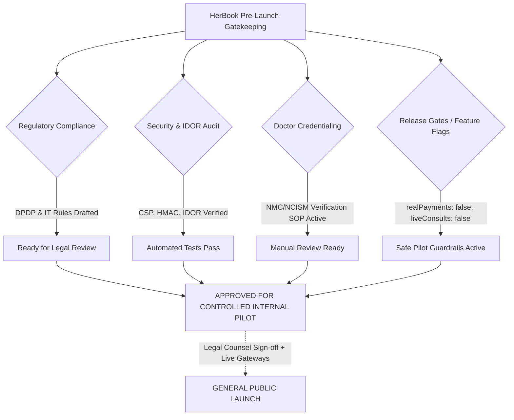

# HerBook Pre-Launch Compliance & Security Checklist
> **Classification:** INTERNAL GOVERNANCE & LAUNCH GATEKEEPING  
> **Status:** PRE-PILOT / AUDIT DRAFT  
> **Jurisdiction:** Republic of India  
> **Brand:** HerBook ("Her Body. Her Health. Her World.")  
> **Target Release Model:** Closed Controlled Beta / Staged Pilot  
> **Last Updated:** October 2026  

---

## Executive Summary

This checklist establishes the mandatory statutory, clinical, security, and technical gates that **must** be verified before transitioning HerBook from internal testing to a controlled public beta or general availability in India.

Until all gates in Sections 1 through 7 achieve an **APPROVED & VERIFIED** status with accompanying independent legal and clinical sign-offs, live medical appointments, unverified public doctor registrations, and real money payment collection **must remain strictly disabled behind feature flags**.

---

## 1. Statutory & Regulatory Compliance Gate (India)

| Check ID | Statutory Framework | Requirement / Control | Implementation Status | Responsible Lead | Sign-Off Date |
|---|---|---|---|---|---|
| **STAT-01** | **Digital Personal Data Protection (DPDP) Act, 2023** | Clear, specific, informed consent notice before collection of health, menstrual cycle, and personal data. Separate consent notices for cycle tracking vs social community. | **IMPLEMENTED** (Draft consent notices & DPDP API in `/api/user/privacy`) | Data Protection Officer / Legal Counsel | Pending Legal Review |
| **STAT-02** | **DPDP Act, 2023 (Section 12)** | Data principal right to withdraw consent and right to erasure (data deletion) with automated processing within 30 days. | **IMPLEMENTED** (Self-service export & erasure request endpoints active) | Backend Lead | Pending Legal Review |
| **STAT-03** | **Information Technology (SPDI) Rules, 2011** | Privacy Policy published with explicit designation of Sensitive Personal Data or Information (SPDI), purpose specification, and non-disclosure clauses. | **IMPLEMENTED** (`docs/legal/privacy-policy-draft.md`) | Legal Counsel | Pending Final Legal Sign-off |
| **STAT-04** | **IT (Intermediary Guidelines) Rules, 2021** | Grievance Officer appointed, contact details prominently displayed in footer/policy, with 24-hour acknowledgment and 15-day resolution SLAs. | **IMPLEMENTED** (Designated in policies & `/api/community/report` with 72h priority triage for non-consensual imagery) | Grievance Officer / Operations | Ready for Appointee Sign-off |
| **STAT-05** | **IT Rules, 2021 (Rule 3(2)(b))** | Rapid takedown mechanism (within 24 hours) for non-consensual intimate imagery, harassment, or defamatory sexual content. | **IMPLEMENTED** (`intimate_image_abuse` priority ticket routing in moderation API) | Trust & Safety Lead | Verified in Moderation Queue |
| **STAT-06** | **Telemedicine Practice Guidelines, 2020** | Explicit patient consent documented prior to every virtual consultation (versioned: `v1.2-IN-TELEMED`). Emergency SOS exclusion disclaimers visible. | **IMPLEMENTED** (`src/components/care/BookingModal.tsx`) | Medical Director | Verified |
| **STAT-07** | **Telemedicine Guidelines (Section 3.7.4)** | Strict prohibition on remote prescribing of Schedule X psychotropic and habit-forming drugs. | **IMPLEMENTED** (`PRESCRIPTION_RESTRICTIONS` in `src/lib/featureFlags.ts`) | Clinical Advisory Board | Verified |
| **STAT-08** | **NMC, NCISM & NCH Acts** | Distinct verification workflows for Allopathic (NMC), Ayurvedic/Unani/Siddha (NCISM), and Homeopathic (NCH) practitioners. Practice boundaries enforced. | **IMPLEMENTED** (`docs/doctor-verification-sop.md` & `/api/admin/doctors/verify`) | Healthcare Operations | Verified |
| **STAT-09** | **Drugs and Magic Remedies (Objectionable Advertisements) Act, 1954** | Prohibition of unverified medical claims, "miracle cures", or non-evidence-based guarantees regarding PCOS, fertility, or menstrual disorders. | **IMPLEMENTED** (Evidence taxonomy tags & explicit disclaimers in `src/data/educationalArticles.ts`) | Medical Reviewer | Verified |

---

## 2. Technical Security & Infrastructure Gate

| Check ID | Security Domain | Specific Control Enforced | Verification Method | Status |
|---|---|---|---|---|
| **SEC-01** | **Transport Encryption** | TLS 1.3 enforced, HTTP Strict Transport Security (`max-age=31536000; includeSubDomains; preload`). | Automated Header Inspection / Qualys SSL Labs | **ENFORCED** via `middleware.ts` |
| **SEC-02** | **Clickjacking & Framing** | `X-Frame-Options: DENY` and `frame-ancestors 'none'` in Content Security Policy. | Browser automated security test | **ENFORCED** via `middleware.ts` |
| **SEC-03** | **Content Sniffing & XSS** | `X-Content-Type-Options: nosniff`, strict CSP script-src boundaries. | Static code analysis & header checks | **ENFORCED** via `middleware.ts` |
| **SEC-04** | **Session Security** | HMAC-SHA256 authenticated cookies with `HttpOnly; Secure; SameSite=Strict; Path=/`. Zero sensitive data in localStorage. | Automated authentication unit tests | **ENFORCED** via `src/lib/auth.ts` |
| **SEC-05** | **Rate Limiting** | Sliding window rate limiting on all `/api/` endpoints (60 req/min/IP) and login throttling (5 failed attempts trigger 15-minute lockout). | Vitest load/brute-force test | **ENFORCED** via `middleware.ts` & `auth.ts` |
| **SEC-06** | **Authorization & IDOR Protection** | Server-side cryptographic ownership checks on all private health records (`/api/records/[id]`) and menstrual logs. | Automated IDOR vulnerability tests | **ENFORCED** via `src/app/api/records/[id]` |
| **SEC-07** | **Administrative MFA** | Multi-Factor Authentication challenge required for role escalation and doctor/admin operations. | Vitest MFA route tests | **ENFORCED** via `/api/auth/mfa` |
| **SEC-08** | **Audit Logging** | Immutable audit log capturing user role changes, doctor verification state changes, health record accesses, and moderation actions. | Log inspection in Admin Console | **ENFORCED** via `logAuditEvent()` |

---

## 3. Feature Flags & Safe Staging Gate

| Feature Flag Key | Purpose | Expected Pre-Launch State | Current State | Release Criteria |
|---|---|---|---|---|
| `realPayments` | Disables real UPI/card gateways; prevents unauthorized financial transactions. | **`false`** | **`false`** (Disabled) | PCI-DSS compliant payment gateway merchant agreement signed; RBI e-mandate guidelines audited. |
| `liveDoctorBookings` | Restricts booking to synthetic demonstration doctors with explicit warnings; blocks real patient billing. | **`false`** | **`false`** (Disabled) | Minimum 10 verified RMPs onboarded; professional indemnity insurance verified; teleconsult SOP tested. |
| `publicDoctorRegistration` | Restricts clinician onboarding to authorized invite-only pilot applications. | **`false`** | **`false`** (Disabled) | Background check vendor integrated; administrative credential verification team staffed. |
| `autonomousAIPrescriptions` | **PERMANENT PROHIBITION** under Indian Telemedicine Guidelines 2020. | **`false`** (Permanent) | **`false`** (Permanent) | Legally prohibited. AI assists only with symptom tracking and general educational information. |

---

## 4. Clinician Onboarding & Credential Verification Gate

| Step | Verification Milestone | Document / Evidence Required | Verification Tool | Sign-off |
|---|---|---|---|---|
| **V-01** | Identity Verification | Government-issued photo ID (Aadhaar/Passport/Driving License). Masked storage. | Administrative manual check | Healthcare Ops |
| **V-02** | Medical Council Registration | Active state/central registration with NMC, State Medical Council, NCISM, or NCH. | IMR / State Register search | Credentialing Officer |
| **V-03** | Degree & Qualification Validation | Primary medical qualification (MBBS/BAMS/BHMS) and specialized postgraduate degrees. | Verification with awarding university / Digilocker | Credentialing Officer |
| **V-04** | Telemedicine Orientation | Completion of Telemedicine Practice Guidelines module as recommended by NMC. | Training declaration | Medical Director |
| **V-05** | Legal Undertaking | Signed Doctor Agreement with indemnification, confidentiality, and Schedule X compliance clauses. | Executed electronic contract | Legal Counsel |

---

## 5. Trust, Safety & Social Network Moderation Gate

- [x] **Abuse Reporting Categories:** Standardized reporting options for harassment, unauthorized intimate media, unverified health claims, hate speech, commercial spam, and impersonation (`src/app/api/community/report/route.ts`).
- [x] **Blocking & Muting:** Server-side blocking and content suppression preventing abusive accounts from contacting victims (`src/app/api/community/block/route.ts`).
- [x] **Emergency SOS Distinction:** All platform views, SOS screen, and doctor consultation modals clearly declare that HerBook is **not** a replacement for emergency ambulance, suicide helpline, or hospital trauma care.
- [x] **Content Taxonomy Labels:** Educational articles and community posts feature clear evidence-based vs user-opinion labels, with explicit clinical boundaries on alternative medicine.

---

## 6. Pre-Launch Documentation Suite Verification

All 11 required governance, legal, and operational manuals have been authored:

1. `docs/launch-readiness-audit.md` (Security & compliance vulnerability matrix)
2. `docs/doctor-verification-sop.md` (Standard operating procedure for RMP credentialing)
3. `docs/launch-readiness-checklist.md` (This document)
4. `docs/legal/privacy-policy-draft.md` (DPDP Act & SPDI Rules compliant draft)
5. `docs/legal/terms-of-service-draft.md` (IT Rules 2021 intermediary terms)
6. `docs/legal/doctor-agreement-draft.md` (Clinician teleconsultation contract)
7. `docs/legal/teleconsultation-consent-draft.md` (Informed patient consent form `v1.2-IN-TELEMED`)
8. `docs/legal/community-guidelines-draft.md` (Social safety rules and anti-harassment policy)
9. `docs/legal/refund-cancellation-policy-draft.md` (Transparent consumer protection terms)
10. `docs/legal/creator-agreement-draft.md` (Influencer and healthcare educator guidelines)
11. `docs/security/incident-response-plan.md` & `docs/security/data-retention-policy.md` (CERT-In 6-hour incident reporting and DPDP data lifecycle)

> **Notice:** All policies in `docs/legal/` are marked `DRAFT — REQUIRES INDIAN LEGAL REVIEW` and must be approved by qualified Indian advocates prior to production rollout.

---

## 7. Final Go / No-Go Launch Matrix

---

### Authorized Pre-Launch Approvals

- **Technical Architecture Sign-off:** Lead Full-Stack & Security Engineer
- **Clinical Governance Sign-off:** Medical Advisory Board Liaison
- **Statutory Review Sign-off:** Empanelled Indian Legal Counsel *(Pending formal signature)*
